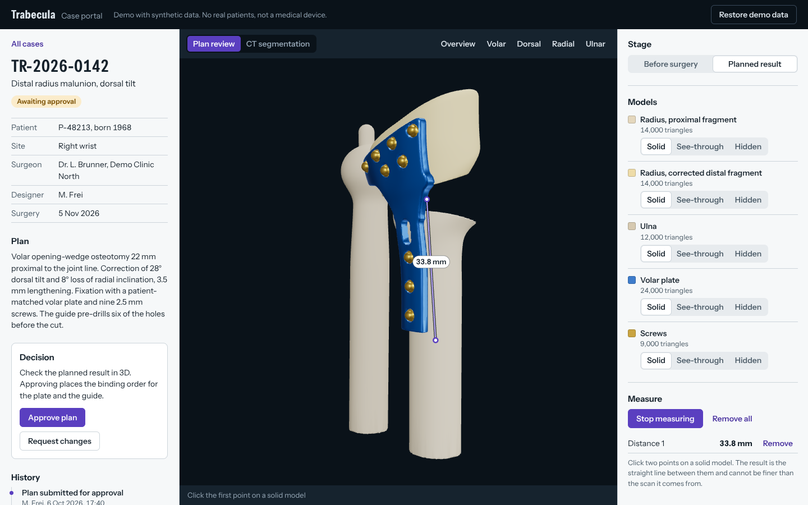
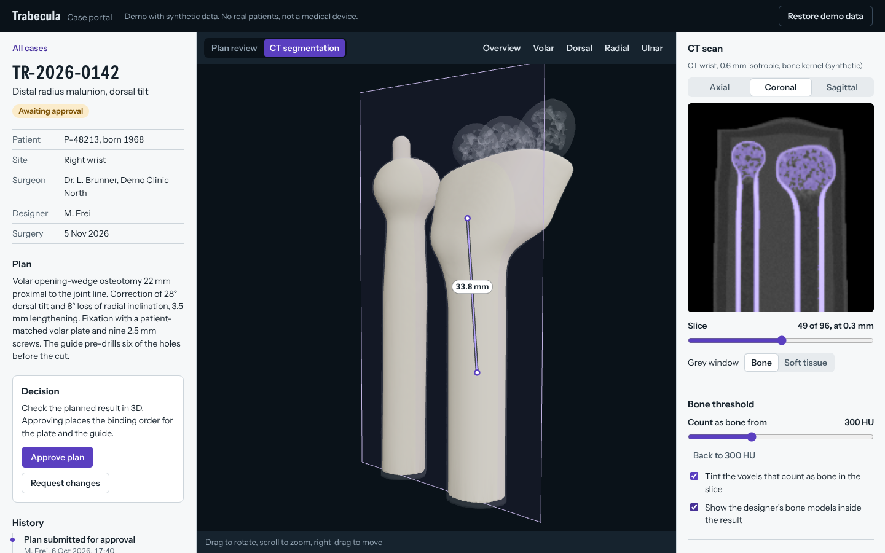

# Trabecula case portal

A small web portal for reviewing patient-specific surgical plans in 3D. A surgeon opens a
case, looks at the planned plate and cutting guide on the patient's bone, measures, checks the
CT scan the models were made from, and approves the plan or sends it back to the designer.

It is a demo: three synthetic cases of a malunited distal radius, no real patient data, not a
medical device.





## What you can do in it

- **Review the plan.** Switch between the anatomy before surgery (with the cutting and drilling
  guide) and the planned result (cut, corrected, plated). Show each model solid, see-through or
  not at all.
- **Measure.** Click two points on a model to get the distance in millimetres.
- **Check the scan.** Scroll through the CT in three orientations. Move the bone threshold and
  the 3D surface is rebuilt from the voxels while you drag.
- **Decide.** Approve the plan, or request changes with a comment. Every step lands in the
  case history.

## Run it

You need Docker.

```bash
docker compose up --build
```

Then open <http://localhost:4200>. The first build downloads the Maven and npm dependencies and
takes a few minutes.

"Restore demo data" in the top bar puts the three cases back to their original state.

### Run it for development

You need Java 21, Maven 3.9, and Node 24 (or 22.22.3 and later).

```bash
docker compose up db                   # PostgreSQL on localhost:5432
cd backend  && mvn spring-boot:run     # API on http://localhost:8080
cd frontend && npm ci && npm start     # app on http://localhost:4200, /api proxied to the API
```

## How it is built

```
backend/     Spring Boot 3.5, Java 21, PostgreSQL 17, Flyway
frontend/    Angular 22, TypeScript, three.js
tools/       Python script that generates the synthetic cases
```

### Backend

| Endpoint | What it does |
| --- | --- |
| `GET /api/cases` | Case list, nearest surgery first |
| `GET /api/cases/{id}` | One case with its models, scan geometry, history and the actions allowed right now |
| `POST /api/cases/{id}/transitions` | `SUBMIT_FOR_APPROVAL`, `APPROVE` or `REQUEST_CHANGES` |
| `GET /api/cases/{id}/models/{modelId}/file` | A model as binary STL |
| `GET /api/cases/{id}/volume/data` | The CT voxels, int16, gzip-encoded |
| `POST /api/demo/reset` | Restores the demo cases (only while `portal.demo.enabled` is true) |

Choices worth knowing about:

- **The workflow lives in the domain.** `CaseWorkflow` is a transition table and `SurgicalCase`
  applies it, so the rules can be tested without Spring. The API returns `allowedActions`, and
  the frontend offers exactly those.
- **Approving is guarded twice.** A transition carries the `version` of the case the user was
  looking at. If the case has changed since, the answer is `409` instead of an approval of a
  plan nobody reviewed. A JPA `@Version` column catches two requests that race.
- **Every status change is an audit entry**: who, when, from, to, and the comment.
- **Large files stay out of the database.** Rows carry a storage key; `AssetStorage` resolves
  it. Today that reads from the classpath; object storage fits behind the same interface.
- **Errors are RFC 9457 problem documents** with a `detail` meant for the user and a `code`
  meant for client code.
- **Flyway owns the schema.** Hibernate never creates tables; the integration test runs its
  schema validation against the migrated database.

### Frontend

- **`viewer3d/scene-engine.ts`** is the WebGL scene and has no Angular in it. It renders on
  demand (nothing is drawn while the picture does not change), picks points by ray casting, and
  draws measurements in an SVG layer so they stay sharp at any zoom.
- **`viewer3d/viewport.ts`** is the thin Angular component that feeds the engine from signals.
- **The viewer is a lazy route**, so three.js is not part of the first download.
- **State is signals** in the page component; panels are plain input/output components.

### The voxel part

- **`voxel/marching-cubes.ts`** turns the CT grid into a triangle mesh at a threshold. Vertices
  are shared through an edge cache that only ever holds two slices, normals come from the
  gradient of the data, and the threshold is a float so the surface moves smoothly. The unit
  tests check it on a sphere: closed, facing outwards, volume within 1 %.
- **`voxel/surface.worker.ts`** runs it off the main thread. `SurfaceExtractor` keeps only the
  newest pending threshold, so dragging the slider costs a handful of extractions rather than
  one per mouse event. On the demo volume (1.7 million voxels) one extraction takes roughly a
  tenth of a second.
- **`voxel/slice.ts`** renders axial, coronal and sagittal slices with a grey window in
  Hounsfield units and tints the voxels the threshold keeps.
- The volume is padded with one layer of air before extraction. A scan ends where the field of
  view ends, and without the padding every bone would be an open tube.

### The demo data

`tools/demo-data/generate.py` builds each case from a few deformity parameters. Bones are
implicit surfaces. The malunion is a rigid transform blended in over the fracture zone, the
plan is the inverse of it applied to the distal fragment, the plate and the guide are offset
shells of the bone they sit on, and the guide's drill sleeves are carried back through the
deformity so that holes drilled before the cut line up with the plate afterwards. The CT volume
is sampled from the same functions, with cortical and cancellous bone, soft tissue, partial
volume and noise.

Everything is in millimetres in one frame, so the models, the CT surface and the slice
indicator line up without any registration step.

```bash
pip install -r tools/demo-data/requirements.txt
python tools/demo-data/generate.py     # rewrites backend/src/main/resources/demo-assets
```

## Tests

| Command | Covers |
| --- | --- |
| `mvn verify` in `backend/` | Workflow rules, the HTTP contract (MockMvc), and the whole application against PostgreSQL in Testcontainers |
| `npm test` in `frontend/` | Marching cubes, slice rendering, the worker scheduling, API client, list and decision components |
| `npm run e2e` in `frontend/` | Playwright against the running Compose stack: review, measure, move the threshold, approve, request changes |

`.github/workflows/ci.yml` runs all three on every push.

## Working with AI coding agents

This project was built with an AI coding agent. [AGENTS.md](AGENTS.md) holds the rules the
agent works under and the checks a change has to pass before it counts as done.

## Hosting it

Any machine with Docker will do; the stack needs about 1 GB of memory.

```bash
DB_PASSWORD=choose-one WEB_PORT=80 docker compose up -d --build
```

Only the web container listens on a public port. Put TLS in front of it (Caddy, Traefik or the
host's load balancer).

## What is left out on purpose

- **Sign-in and roles.** Anyone can take any action, and the history records the person whose
  step it is. This is the first thing a real deployment needs.
- **Uploads.** Cases cannot be created; DICOM and STL upload are not implemented.
- **GPU volume rendering.** The scan is shown as slices and as an extracted surface.
- **Saved measurements.** They live in the browser tab only.
- **OpenAPI documentation** for the API.

## Third-party material

- The marching cubes lookup table comes from three.js (MIT), after Paul Bourke's public-domain
  formulation of Lorensen and Cline's algorithm.
- The typeface is Instrument Sans (SIL Open Font License).
